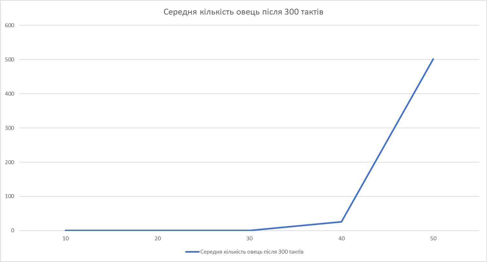
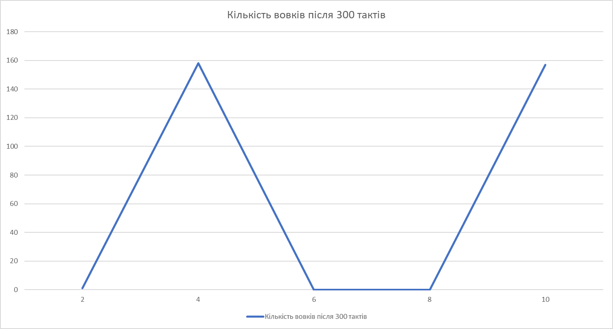
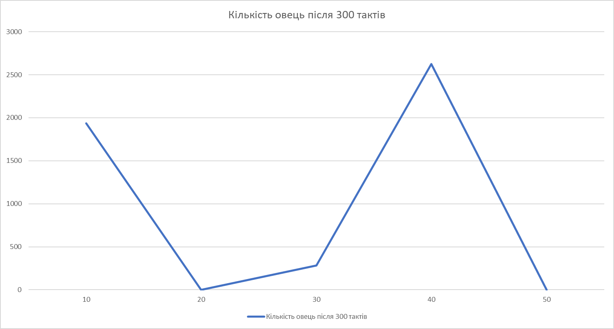

## Комп'ютерні системи імітаційного моделювання

## Група СПм-25-1, ПІБ Кондратюк І.О.

### Лабораторна робота №1. Опис імітаційних моделей та проведення обчислювальних експериментів

### Варіант 7, модель у середовищі NetLogo:

[Wolf Sheep Predation](https://ccl.northwestern.edu/netlogo/models/WolfSheepPredation)

### Вербальний опис моделі:

Модель імітує взаємодію популяцій вовків, овець та рослинності в обмеженій екосистемі. Вовки виступають хижаками, які полюють на овець, а вівці споживають траву для підтримання життєдіяльності.

Кожна тварина представлена окремим агентом, який випадково переміщується середовищем, витрачає енергію, харчується та розмножується з певною ймовірністю. Якщо запас енергії агента вичерпується, він гине. Вовки отримують енергію, поїдаючи овець, а вівці — споживаючи траву, яка поступово відновлюється.

Модель дозволяє дослідити вплив чисельності популяцій, швидкості розмноження та доступності харчових ресурсів на стабільність екосистеми.

Для дослідження використовується версія `sheep-wolves-grass`, яка враховує всі три компоненти екосистеми.

### Керуючі параметри:

- **model-version** - визначає варіант моделювання: лише вовки та вівці або вовки, вівці та трава.
- **initial-number-sheep** - задає початкову кількість овець у середовищі.
- **initial-number-wolves** - задає початкову кількість вовків у середовищі.
- **sheep-gain-from-food** - кількість енергії, яку отримує вівця після споживання трави.
- **wolf-gain-from-food** - кількість енергії, яку отримує вовк після поїдання вівці.
- **sheep-reproduce** - імовірність розмноження кожної вівці протягом одного такту моделювання, у відсотках.
- **wolf-reproduce** - імовірність розмноження кожного вовка протягом одного такту моделювання, у відсотках.
- **grass-regrowth-time** - кількість тактів, необхідних для відновлення трави після її споживання.
- **show-energy?** - визначає, чи відображатиметься поточна енергія тварин у середовищі моделювання.

### Внутрішні параметри:

- **energy** - поточний запас енергії окремого агента. Зменшується під час руху та збільшується після споживання їжі. У разі від'ємного значення енергії агент гине.
- **countdown** - внутрішній лічильник часу до відновлення трави на окремій ділянці середовища.
- **max-sheep** - обмеження максимальної чисельності овець, призначене для запобігання надмірному зростанню популяції.
- **heading** - напрямок руху окремого агента, який змінюється випадковим чином.
- **xcor, ycor** - поточні координати агента в середовищі моделювання.
- **pcolor** - колір ділянки середовища, який позначає наявність або відсутність трави.
- **ticks** - лічильник модельного часу, що визначає кількість виконаних тактів симуляції.

### Показники роботи системи:

- **Кількість овець** - поточна чисельність популяції травоїдних тварин.
- **Кількість вовків** - поточна чисельність популяції хижаків.
- **Кількість трави** - число ділянок середовища, на яких доступна трава.
- **Динаміка популяцій** - зміна чисельності вовків, овець та доступної трави протягом модельного часу.
- **Стабільність екосистеми** - здатність популяцій співіснувати протягом тривалого часу без повного вимирання одного з видів.

### Недоліки моделі:

- Агенти переміщуються випадковим чином, без цілеспрямованого пошуку їжі або уникнення хижаків.
- У моделі не враховуються вік тварин, природні захворювання та сезонні зміни.
- Розмноження відбувається з фіксованою ймовірністю, яка безпосередньо не залежить від віку чи запасу енергії тварини.
- Усі особини одного виду використовують однакові правила поведінки.

---

## Обчислювальні експерименти

Для дослідження використовується версія моделі `sheep-wolves-grass`.

У кожному експерименті змінюється лише один керуючий параметр. Усі інші параметри залишаються незмінними.

Базові значення параметрів, обрані для дослідження:

- **initial-number-sheep:** 100
- **initial-number-wolves:** 50
- **sheep-reproduce:** 4%
- **wolf-reproduce:** 5%
- **sheep-gain-from-food:** 4
- **wolf-gain-from-food:** 20
- **grass-regrowth-time:** 30
- **show-energy?:** off

Тривалість кожного запуску - до 300 тактів. Якщо симуляція автоматично припиняється раніше, фіксується фактичний момент зупинки та стан популяцій.

### 1. Вплив початкової кількості вовків на чисельність популяції овець

Досліджується залежність чисельності овець після 300 тактів моделювання від початкової кількості вовків в екосистемі.
Керуючий параметр **initial-number-wolves** змінюється від 10 до 50 з кроком 10. Усього досліджується 5 конфігурацій.
Інші параметри мають базові значення, наведені вище.

| Початкова кількість вовків | Кількість овець після 300 тактів |
|---|---|
| 10 | 0 |
| 20 | 0 |
| 30 | 0 |
| 40 | 26 |
| 50 | 502 |

**Графік 1.** Залежність чисельності овець від початкової кількості вовків.

За результатами моделювання встановлено нелінійну залежність чисельності овець від початкової кількості вовків. 
При початковій чисельності хижаків від 10 до 30 особин популяція овець повністю зникла. При 40 вовках після 300 тактів залишилося 26 овець, через повне вимирання вовків, навідміну від попередніх випадків де спочатку вимирали вівці. При 50 вовках їх кількість становила 502 особин, так само через смерть усіх вовків. Які вимирають через свою хаотичну поведінку, іноді при велетенській кількості овець.

### 2. Вплив імовірності розмноження овець на чисельність популяції вовків

Досліджується залежність чисельності вовків після 300 тактів моделювання від імовірності розмноження овець.
Керуючий параметр **sheep-reproduce** змінюється від 2% до 10% з кроком 2%. Усього досліджується 5 конфігурацій.
Інші параметри мають базові значення, наведені вище.

| Імовірність розмноження овець, % | Кількість вовків після 300 тактів |
|---|---|
| 2 | 1 |
| 4 | 158 |
| 6 | 0 |
| 8 | 0 |
| 10 | 157 |

**Графік 2.** Залежність чисельності вовків від імовірності розмноження овець.

За результатами другого експерименту встановлено, що імовірність розмноження овець суттєво впливає на чисельність популяції вовків. При значенні 2% після 300 тактів залишився лише один вовк. Збільшення імовірності до 4% супроводжувалося зростанням чисельності вовків до 158 особин. При значеннях 6% та 8% популяція вовків повністю зникла, тоді як при 10% чисельність становила 157 особин, в цьому випадку вовки просто невстигли вимерти але їх чисельність спала з 30+ до 157 за 50-60 тактів.

### 3. Вплив швидкості відновлення трави на чисельність популяції овець

Досліджується залежність чисельності овець після 300 тактів моделювання від часу, необхідного для відновлення трави після її споживання.
Керуючий параметр **grass-regrowth-time** змінюється від 10 до 50 тактів з кроком 10. Усього досліджується 5 конфігурацій.
Інші параметри мають базові значення, наведені вище.

| Час відновлення трави, такти | Кількість овець після 300 тактів |
|---|---|
| 10 | 1938 |
| 20 | 0 |
| 30 | 283 |
| 40 | 2624 |
| 50 | 0 |

**Графік 3.** Залежність чисельності овець від часу відновлення трави.

За результатами третього експерименту встановлено, що час відновлення трави суттєво впливає на чисельність популяції овець. При значенні 10 тактів після 300 кроків моделювання чисельність овець становила 1938 особин. При 20 тактах популяція овець повністю зникла. Для значення 30 тактів після завершення моделювання залишилося 283 вівці. Найбільше значення було отримано при 40 тактах - 2624 особини. При 50 тактах популяція овець знову повністю зникла.

