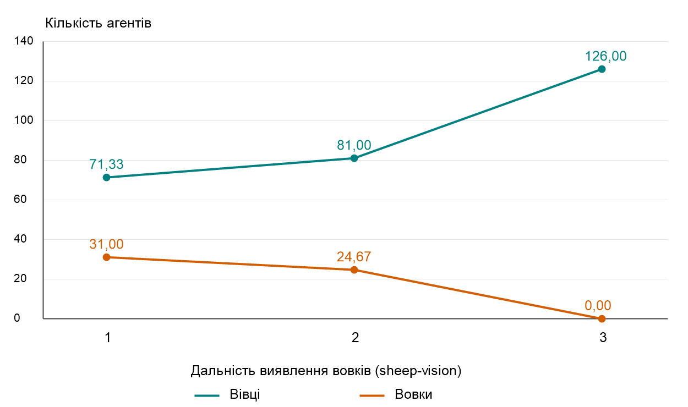

# Лабораторна робота №2

**Дисципліна:** Комп’ютерні системи імітаційного моделювання  
**Тема:** Редагування імітаційних моделей у середовищі NetLogo  
**Варіант:** №7 — Wolf Sheep Predation  
**Виконав(ла):** Кондратюк Ілля Олегович  
**Група:** СПм-25-1

## Мета роботи

Ознайомитися із синтаксисом мови NetLogo, навчитися змінювати логіку готової агентної моделі та дослідити вплив внесених змін на її поведінку.

## Початкова модель

Для роботи використано модель **Wolf Sheep Predation** з бібліотеки NetLogo. Модель описує взаємодію хижаків — вовків — і здобичі — овець. У версії `sheep-wolves-grass` додатково враховуються поїдання та відновлення трави.

Вівці та вовки є окремими типами активних агентів (`breeds`). Кожна тварина має запас енергії. Вовки витрачають енергію під час руху та поповнюють її, поїдаючи овець. У версії з травою вівці також витрачають енергію на рух і поповнюють її під час харчування. Розмноження відбувається з імовірністю, заданою параметрами моделі; енергія ділиться між батьківським агентом та нащадком.

У початковій моделі обидва види рухаються випадково, без цілеспрямованого пошуку здобичі або втечі від хижаків.

## Завдання за варіантом

1. Змінити рух вовків: перед ходом вони перевіряють оточення та обирають напрямок з урахуванням наявності овець і відсутності інших вовків. Якщо відповідного варіанта немає, рухаються випадково.
2. При перебуванні кількох вовків на одній клітинці залишати лише одного.
3. Змінити рух овець: за відсутності небезпеки вони рухаються випадково, а при виявленні вовка на сусідній клітинці змінюють напрямок на протилежний.
4. Додати власне вдосконалення та провести обчислювальний експеримент.

## Обов’язкові зміни за варіантом №7

Наведений опис відповідає запропонованій реалізації. Перед здачею необхідно перевірити його відповідність остаточному коду моделі.

### Рух вовків

Для вовків додано процедуру `move-wolf`. Вона перевіряє вісім сусідніх клітинок (`neighbors`) і відбирає ті, на яких немає вовків. Серед цих клітинок обираються клітинки з вівцями.

Якщо придатні клітинки зі здобиччю є, вовк випадково обирає одну з них, повертається до неї та переходить на неї за допомогою `move-to`. Якщо таких клітинок немає, виконується початкова процедура випадкового руху `move`.

У процедурі `go` виклик `move` для вовків замінено на `move-wolf`. Логіку витрат енергії, поїдання овець та розмноження збережено.

```netlogo
to move-wolf
  let available-patches neighbors with [ not any? wolves-here ]
  let hunting-patches available-patches with [ any? sheep-here ]

  ifelse any? hunting-patches [
    let target one-of hunting-patches
    face target
    move-to target
  ] [
    move
  ]
end
```

### Усунення скупчень вовків

Додано процедуру `resolve-wolf-conflicts`. На кожній клітинці, де перебуває більше одного вовка, випадково обирається один агент, який залишається. Решта вовків на цій клітинці видаляються командою `die`.

Процедура викликається після початкового створення вовків у `setup`, а також перед і після виконання блоку дій вовків у `go`. Таким чином усуваються скупчення, які виникають під час початкового розміщення, руху та розмноження. Перевірка після блоку дій означає, що зіткнення усуваються наприкінці цього блоку, а не миттєво після кожного переміщення.

```netlogo
to resolve-wolf-conflicts
  ask patches with [ count wolves-here > 1 ] [
    let survivor one-of wolves-here
    ask wolves-here with [ self != survivor ] [ die ]
  ]
end
```

### Втеча овець

Додано процедуру `move-sheep`. Вівця перевіряє доступну їй область спостереження. Якщо в ній є вовки, обирається найближчий. Вівця повертається в його бік, розвертається на 180 градусів і проходить один крок.

Якщо вовк перебуває точно на позиції вівці, напрямок втечі обирається випадково. За відсутності вовків виконується звичайний випадковий рух.

У процедурі `go` виклик `move` для овець замінено на `move-sheep`.

Для виконання лише вимоги варіанту область пошуку вовків задається рядком:

```netlogo
let threats wolves-on neighbors
```

У кінцевій реалізації ця область розширена власним доповненням `sheep-vision`, описаним нижче. Саме рішення тікати від вовка належить до обов’язкових змін.

### Зміни у викликах процедур

Наприкінці `setup`, після створення тварин, додано:

```netlogo
resolve-wolf-conflicts
display-labels
reset-ticks
```

У `go` вівці викликають `move-sheep` замість `move`. Блок дій вовків має такий вигляд:

```netlogo
resolve-wolf-conflicts
ask wolves [
  move-wolf
  set energy energy - 1
  eat-sheep
  death
  reproduce-wolves
]
resolve-wolf-conflicts
```

Початкову процедуру `move` збережено для випадкового руху обох видів:

```netlogo
to move
  rt random 50
  lt random 50
  fd 1
end
```

## Власне вдосконалення: дальність виявлення вовків

Додано повзунок `sheep-vision`, який задає дальність виявлення вовків вівцями.

| Налаштування | Значення |
|---|---|
| Назва змінної | `sheep-vision` |
| Мінімальне значення | 1 |
| Максимальне значення | 10 |
| Крок | 1 |
| Початкове значення | 1 |

Змінна створюється повзунком інтерфейсу, тому окремо в `globals` не оголошується.

Область спостереження формується так:

```netlogo
let visible-patches (patch-set neighbors patches in-radius sheep-vision)
let threats wolves-on visible-patches
```

Усі вісім сусідніх клітинок перевіряються незалежно від значення повзунка. Збільшення `sheep-vision` розширює область спостереження за рахунок клітинок, центри яких лежать у заданому радіусі від вівці. Перевіряється також поточна клітинка. Це дозволяє змінювати дальність виявлення небезпеки, зберігаючи реакцію на вовків у сусідніх клітинках, передбачену варіантом.

Повна процедура руху овець після внесення обов’язкової та власної змін:

```netlogo
to move-sheep
  let visible-patches (patch-set neighbors patches in-radius sheep-vision)
  let threats wolves-on visible-patches

  ifelse any? threats [
    let nearest-wolf min-one-of threats [ distance myself ]
    ifelse distance nearest-wolf > 0 [
      face nearest-wolf
      rt 180
    ] [
      set heading random-float 360
    ]
    fd 1
  ] [
    move
  ]
end
```

## Власне вдосконалення: старіння та тривалість життя

У початковій моделі немає обмеження віку тварин. До моделі додано старіння та загибель після досягнення індивідуальної тривалості життя. Параметри для овець і вовків регулюються окремо.

### Нові властивості агентів

Спільні властивості тварин розширено:

```netlogo
turtles-own [
  energy
  age
  lifespan
]
```

`age` — поточний вік агента в тактах; `lifespan` — індивідуальна тривалість життя. Граничний строк життя не гарантує виживання до цього віку: зберігаються загибель від нестачі енергії, поїдання овець та усунення скупчень вовків.

### Окремі повзунки для двох видів

| Параметр | Призначення | Мінімум | Максимум | Крок | Початкове значення |
|---|---|---|---|---|---|
| `sheep-mean-lifespan` | Середнє призначене значення тривалості життя овець | 10 | 1000 | 10 | 300 |
| `wolf-mean-lifespan` | Середнє призначене значення тривалості життя вовків | 10 | 1000 | 10 | 300 |

Тривалість задається в тактах моделі. Для кожної тварини випадково призначається власне значення приблизно в межах 80–120% від відповідного повзунка. Наприклад, при значенні 300 це приблизно 240–360 тактів. Отже, повзунок визначає центр розподілу призначеної тривалості життя, а не фактичний середній вік живої популяції.

```netlogo
to initialize-lifespan
  let mean-life 0

  ifelse breed = sheep [
    set mean-life sheep-mean-lifespan
  ] [
    set mean-life wolf-mean-lifespan
  ]

  set lifespan max (list 1
    (round (mean-life * (0.8 + random-float 0.4))))
  set age 0
end
```

У `setup` після розміщення агентів у кожному з блоків `create-sheep` та `create-wolves` додано:

```netlogo
initialize-lifespan
set age random lifespan
```

Початкові тварини мають різний вік, щоб популяція складалася з різних вікових груп. Це зменшує синхронність загибелі початкових агентів.

### Старіння на кожному такті

```netlogo
to grow-older
  set age age + 1
  if age >= lifespan [ die ]
end
```

У процедурі `go` після початкових перевірок зупинки, перед діями овець, викликається:

```netlogo
ask turtles [ grow-older ]
```

Таким чином, кожна тварина старіє на один такт перед виконанням дій. Якщо досягнуто призначеної тривалості життя, агент видаляється й не виконує подальших дій цього кроку.

### Вік новонароджених

В обох процедурах розмноження змінено блок створення нащадка:

```netlogo
hatch 1 [
  initialize-lifespan
  rt random-float 360
  fd 1
]
```

Нащадок отримує вік 0 та нове випадкове значення тривалості життя. Вік батьківського агента не переноситься на нього. Зміна повзунка впливає на новостворених тварин; для застосування налаштувань до всієї початкової популяції виконується `setup`.

### Графік середнього віку

В інтерфейсі додано графік **«Середній вік тварин»**. Горизонтальна вісь показує такти, вертикальна — середній вік живих агентів у тактах. На графіку відображаються дві лінії.

Команда оновлення лінії **«Вівці»**:

```netlogo
if any? sheep [
  plot mean [ age ] of sheep
]
```

Команда оновлення лінії **«Вовки»**:

```netlogo
if any? wolves [
  plot mean [ age ] of wolves
]
```

Графік оновлюється при виконанні `reset-ticks` і `tick`. За відсутності агентів відповідного виду нова точка для нього не додається. Середній вік може знижуватися через народження молодих тварин або загибель старших.

Показник описує вік живих тварин у поточний момент, а не середню тривалість життя померлих агентів. Для останньої потрібен окремий облік віку під час загибелі.

[Додати скриншот інтерфейсу з повзунками тривалості життя та графіком середнього віку.]

## Обчислювальний експеримент для дальності виявлення

Наведений експеримент проведено до додавання старіння та присвячено лише параметру `sheep-vision`. Його результати описують попередню версію моделі без обмеження тривалості життя. Окремі результати експерименту зі старінням у цьому звіті не наведені. У всіх запусках обов’язкові зміни за варіантом увімкнені та залишаються однаковими. Порівняння з початковою моделлю й окремі експерименти для руху вовків, усунення їхніх скупчень або втечі овець не виконуються.

### Мета та гіпотеза

Мета експерименту — визначити, як дальність виявлення вовків впливає на чисельність овець і вовків у зміненій моделі.

Досліджуваний керуючий параметр — `sheep-vision`. Вихідні показники — кількість овець і вовків на 500-му такті та випадки зникнення популяцій.

Гіпотеза: збільшення дальності спостереження дозволяє вівцям раніше реагувати на небезпеку та може підвищити їхню чисельність. При цьому зменшення доступності здобичі може вплинути на виживання вовків. 

### Умови проведення

Використано значення `sheep-vision`: **1, 2 і 3**. Для кожного значення передбачено три незалежні запуски тривалістю 500 тактів. Перед кожним запуском виконується `setup`. Усі інші керуючі параметри залишаються однаковими.

| Параметр | Значення |
|---|---|
| `model-version` | sheep-wolves-grass |
| `initial-number-sheep` | 100 |
| `initial-number-wolves` | 50 |
| `sheep-gain-from-food` | 4 |
| `wolf-gain-from-food` | 20 |
| `sheep-reproduce` | 5 |
| `wolf-reproduce` | 4 |
| `grass-regrowth-time` | 63 |
| Тривалість запуску | 500 тактів |
| Повторень для кожного значення | 3 |


### Результати запусків

| `sheep-vision` | Запуск | Овець на 500-му такті | Вовків на 500-му такті | Примітки: зникнення популяцій або дострокове завершення |
|---|---|---|---|---|
| 1 | 1 | 61 | 27 | ні |
| 1 | 2 | 77 | 30 | ні |
| 1 | 3 | 76 | 36 | ні |
| 2 | 1 | 61 | 33 | ні |
| 2 | 2 | 114 | 11 | ні |
| 2 | 3 | 68 | 30 | ні |
| 3 | 1 | 117 | 0 | так |
| 3 | 2 | 138 | 0 | так |
| 3 | 3 | 123 | 0 | так |

Середня чисельність обчислюється як сума кінцевих чисельностей у трьох запусках, поділена на три. 

| `sheep-vision` | Середня кількість овець | Середня кількість вовків |
|---|---|---|
| 1 | 71,33 | 31,00 |
| 2 | 81,00 | 24,67 |
| 3 | 126,00 | 0 |

Середні обчислено так:

- Для значення 1: вівці — (61 + 77 + 76) / 3 = 71,33; вовки — (27 + 30 + 36) / 3 = 31,00.
- Для значення 2: вівці — (61 + 114 + 68) / 3 = 81,00; вовки — (33 + 11 + 30) / 3 = 24,67.
- Для значення 3: вівці — (117 + 138 + 123) / 3 = 126,00; вовки — (0 + 0 + 0) / 3 = 0,00.


За sheep-vision = 3 вовки зникли в усіх трьох запусках. Спостереження під час моделювання узгоджується з логікою моделі: вівці раніше помічають небезпеку й тікають, а вовки без здобичі втрачають енергію та гинуть.



### Аналіз результатів

У проведених запусках зі збільшенням `sheep-vision` від 1 до 3 середня кількість овець зросла від 71,33 до 126,00, а середня кількість вовків зменшилася від 31,00 до 0,00. За значення 2 середня чисельність становила 81,00 для овець і 24,67 для вовків.

За значення `sheep-vision = 3` вовки зникли в усіх трьох запусках. За спостереженням під час моделювання, вони не могли спіймати овець. Це узгоджується з логікою моделі: раннє виявлення хижака дозволяє вівцям тікати, а вовки без здобичі витрачають енергію та гинуть. За значень 1 і 2 вовки залишалися в усіх зафіксованих результатах. За значення 2 їхня кількість коливалася від 11 до 33, що показує мінливість результатів повторних запусків. Дані підтримують гіпотезу про користь більшої дальності виявлення для овець за досліджених умов, але не доводять неминучого зникнення вовків у кожному можливому запуску.


## Висновки

Під час роботи змінено логіку моделі Wolf Sheep Predation: додано пошук здобичі вовками, усунення скупчень вовків на одній клітинці та втечу овець від хижаків. Власними доповненнями стали регульована дальність виявлення вовків `sheep-vision` та механізм старіння. Для овець і вовків додано окреме налаштування середньої призначеної тривалості життя, випадкові індивідуальні строки життя та коректне встановлення віку нащадків. Для спостереження за віковою структурою додано графік середнього віку живих тварин.

У проведеному експерименті збільшення `sheep-vision` від 1 до 3 супроводжувалося зростанням середньої чисельності овець та зменшенням середньої чисельності вовків. Найбільшу середню кількість овець — 126,00 — отримано за значення 3; при цьому вовки зникли в усіх трьох запусках. Найменшу середню кількість овець — 71,33 — отримано за значення 1. Результати підтримують висунуту гіпотезу в межах досліджених умов.

Результати експерименту з дальністю виявлення отримано до впровадження старіння. Вплив тривалості життя на чисельність популяцій за наведеними даними не оцінювався.
