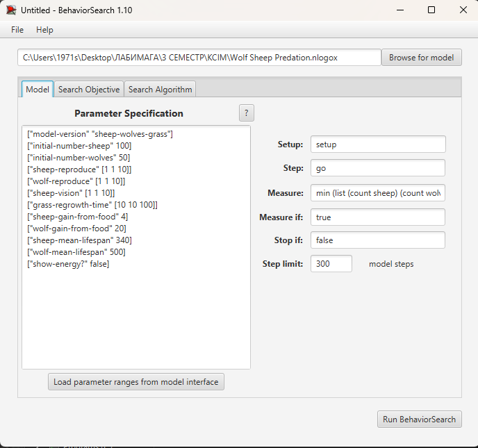
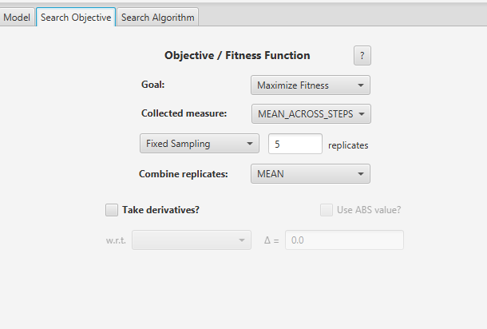
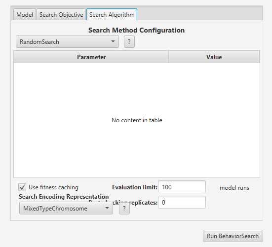
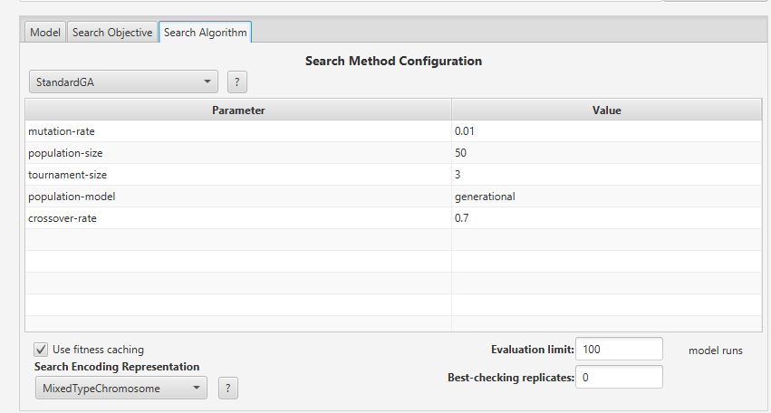
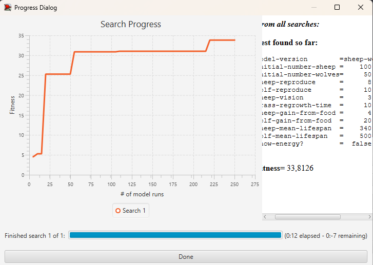

# Лабораторна робота №3

**Дисципліна:** Комп’ютерні системи імітаційного моделювання  
**Тема:** Використання засобів обчислювального інтелекту для оптимізації імітаційних моделей  
**Варіант:** №7 — Wolf Sheep Predation  
**Виконав:** Кондратюк Ілля Олегович  
**Група:** СПм-25-1

## Мета роботи

Дослідити застосування генетичного алгоритму та випадкового пошуку для автоматичного підбору параметрів імітаційної моделі у середовищі BehaviorSearch, порівняти результати оптимізації та перевірити знайдені параметри в NetLogo.

## Опис імітаційної моделі

Для дослідження обрано **Wolf Sheep Predation** із бібліотеки NetLogo — агентну модель взаємодії популяцій вовків і овець. У режимі `sheep-wolves-grass` вівці живляться травою, яка поступово відновлюється, а вовки полюють на овець. Агенти витрачають енергію, можуть розмножуватися та гинуть за визначених моделлю умов.

Використовується модифікована модель із лабораторної роботи №2. У ній змінено поведінку тварин: вовки шукають здобич на сусідніх клітинках, вівці тікають від виявлених хижаків, а скупчення вовків на одній клітинці усуваються. Додано регульовану дальність виявлення хижаків `sheep-vision`, індивідуальний вік і тривалість життя тварин, а також відмінності швидкості руху вовків та овець.

### Керуючі параметри

Для оптимізації обрано чотири параметри:

| Параметр | Призначення | Мінімум | Максимум | Крок |
|---|---|---:|---:|---:|
| `sheep-reproduce` | Імовірність розмноження овець (%) | 1 | 10 | 1 |
| `wolf-reproduce` | Імовірність розмноження вовків (%) | 1 | 10 | 1 |
| `sheep-vision` | Радіус виявлення вовків вівцями | 1 | 10 | 1 |
| `grass-regrowth-time` | Час відновлення трави (такти) | 10 | 100 | 10 |

Кожен параметр має десять допустимих значень. Загалом простір пошуку складається з **10 000 комбінацій**.

| Фіксований параметр | Значення для експерименту |
|---|---|
| `model-version` | `sheep-wolves-grass` |
| `initial-number-sheep` | 100 |
| `initial-number-wolves` | 50 |
| `sheep-gain-from-food` | 4 |
| `wolf-gain-from-food` | 20 |
| `sheep-mean-lifespan` | 340 |
| `wolf-mean-lifespan` | 500|

### Показники роботи моделі

Для аналізу доступні поточна чисельність овець (`count sheep`), поточна чисельність вовків (`count wolves`), зміни цих популяцій у часі та середній вік живих тварин.

## Постановка задачі оптимізації

Завдання полягає в підборі параметрів, що сприяють **одночасному збереженню обох популяцій**. Для цього обрано показник чисельності меншої з двох популяцій:

```netlogo
min (list (count sheep) (count wolves))
```

У BehaviorSearch вибрано ціль **`Maximize Fitness`**. Для кожного запуску оцінюється середнє значення показника за всі такти симуляції (`MEAN_ACROSS_STEPS`). Завдяки цьому зникнення одного виду зменшує оцінку набору параметрів. Водночас високий середній показник сам по собі не гарантує збереження обох популяцій до завершення симуляції, тому це перевіряється окремо в NetLogo.

## Налаштування BehaviorSearch

### Вкладка Model

| Поле | Значення |
|---|---|
| Setup | `setup` |
| Go | `go` |
| Measure | `min (list (count sheep) (count wolves))` |
| Measure if | `true` |
| Stop if | `false` (за відсутності іншої умови) |
| Time limit | 300 тактів |




### Вкладка Search Objective

| Поле | Заплановане значення |
|---|---|
| Goal | `Maximize Fitness` |
| Collected measure | `MEAN_ACROSS_STEPS` |
| Repetitions | 5 |
| Агрегування повторів | Середнє арифметичне |

Повторні запуски потрібні для послаблення впливу випадкових переміщень, народжень і загибелі агентів на оцінку параметрів.



### Спосіб кодування простору пошуку

Вибрано **`MixedTypeChromosome`**. У цьому представленні кожний параметр моделі є окремим компонентом хромосоми відповідного типу, а не частиною суцільного двійкового рядка. Воно зручне для набору дискретних параметрів нашої моделі.

## Оптимізація методом випадкового пошуку (RandomSearch)

Під час першого експерименту використовується **`RandomSearch`**. Алгоритм досліджує випадково вибрані комбінації значень параметрів, оцінює їх за цільовою функцією та зберігає найкращий знайдений результат.

| Поле | Заплановане значення |
|---|---|
| Search algorithm | `RandomSearch` |
| Evaluation limit | 100 |
| Search Encoding Representation | `MixedTypeChromosome` |
| Use fitness caching | + |



### Результати RandomSearch

| Показник | Результат |
|---|---|
| Найкраще значення функції пристосованості | 30,32 |
| `sheep-reproduce` | 9 |
| `wolf-reproduce` | 1 |
| `sheep-vision` | 2 |
| `grass-regrowth-time` | 60 |
| Фактична кількість оцінювань | 5 |
| Час пошуку | 0:06 |

## Оптимізація генетичним алгоритмом (StandardGA)

Для порівняння буде використано `StandardGA`, який удосконалює популяцію кандидатних рішень за допомогою відбору, схрещування й мутації. Модель, цільова функція, діапазони параметрів і порядок оцінювання залишаються тими самими. Обчислювальний бюджет буде узгоджений із випадковим пошуком за фактичною кількістю оцінювань.

| Налаштування / результат | Значення |
|---|---|
| Search algorithm | `StandardGA` |
| Search Encoding Representation | `MixedTypeChromosome` |
| Evaluation limit | 100 |
| Mutation rate | 0.01 |
| Population size | 50 |
| Tournament size | 3 |
| Population model | `generational` |
| Crossover rate | 0.7 |
| Фактична кількість оцінювань | 5 |
| Найкраще значення функції пристосованості | 33,8 |
| `sheep-reproduce` | 8 |
| `wolf-reproduce` | 10 |
| `sheep-vision` | 3 |
| `grass-regrowth-time` | 10 |
| Час пошуку | 0:12 |





## Порівняння результатів

| Показник | RandomSearch | StandardGA |
|---|---|---|
| Найкраще значення функції пристосованості | 30,32 | 33,8 |
| Зазначена кількість оцінювань | 5 | 5 |
| Час роботи | 6 с | 12 с |
| `sheep-reproduce` | 9 | 8 |
| `wolf-reproduce` | 1 | 10 |
| `sheep-vision` | 2 | 3 |
| `grass-regrowth-time` | 60 | 10 |

## Висновки

За результатами оптимізації генетичний алгоритм StandardGA отримав найкраще значення функції пристосованості 33,8, тоді як RandomSearch — 30,32.

Отже, StandardGA продемонстрував результат, вищий приблизно на 11,5%. Водночас час виконання генетичного алгоритму становив 12 секунд проти 6 секунд у випадкового пошуку.

Таким чином, у проведеному експерименті генетичний алгоритм забезпечив краще значення цільової функції, але потребував більше часу на обчислення.
